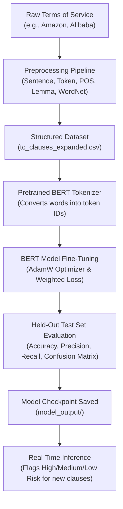

# 1. Project Overview and Core Concepts

## 1. What is this project about?
When you download an app or sign up for a service (like Amazon, Alibaba, Netflix, or Instagram), you are asked to click **"I Agree"** to the **Terms and Conditions (T&C)**.

- **The Problem:** Nobody reads these agreements because they are 10 to 30 pages long, filled with confusing legal jargon ("legalese").
- **The Danger:** Companies hide severe terms inside them:
  - *"We can terminate your account at any moment without giving you a reason or notice."* (Unilateral Termination)
  - *"If our servers crash and you lose thousands of dollars, we will not pay you a penny."* (Limitation of Liability)
  - *"You give up your right to sue us in court or join a class action lawsuit; you must go to private arbitration."* (Mandatory Arbitration)
- **Our Solution:** An automated NLP system that takes legal agreements, cleans and analyzes the language, and classifies each clause into **Low Risk**, **Medium Risk**, or **High Risk**, so users know immediately what they are agreeing to.

---

## 2. The Big Picture: What Was Already Done vs What Was Added

Our project has two major halves:

### Part 1: The Foundational Preprocessing Work (Experiments 1–5 & HMM)
*(Documented in `nlpExps(1-5).pdf` and `hmm-posTagging-implementation.pdf`)*
This part was completed earlier in Google Colab:
- **Experiment 1:** Compared NLP tools (NLTK, spaCy, Hugging Face, Google Cloud NLP, AWS Comprehend).
- **Experiment 2:** Formulated the problem statement and studied legal NLP literature (like ToS;DR).
- **Experiment 3:** Built standard preprocessing (HTML stripping, handling numbers, keeping critical words like "not" and "no").
- **Experiment 4:** Advanced preprocessing (Lemmatization vs Stemming, masking personal data like emails and names for privacy, language detection).
- **Experiment 5:** Parsing sentence grammar (Noun/Verb phrases, finding who does what via Subject-Verb-Object triples, building CFG parse trees).
- **HMM Implementation:** Wrote a Hidden Markov Model with the Viterbi algorithm to predict POS tags from scratch.

### Part 2: The New Requirements Added Now (October 2026 Guidelines)
The instructor required genuine machine learning and deep learning beyond preprocessing:
1. **The 5 Mandatory Preprocessing Tasks:** Packaged into a clean Python script (`preprocessing_pipeline.py`) so anyone can verify them.
2. **Dataset Expansion:** Expanded our seed dataset from 17 clauses to 82 clauses from 11 real platforms (`tc_clauses_expanded.csv`).
3. **Genuine Fine-Tuning of a Pretrained LLM/Transformer:** Used a real BERT model (`bert-tiny`) and updated its neural network parameters using PyTorch.
4. **Baseline Benchmarking:** Built a classical ML model (TF-IDF + Logistic Regression) to compare against our BERT model.
5. **Rigorous Evaluation:** Measured Accuracy, Precision, Recall, Macro F1, and the Confusion Matrix on an unseen test set.
6. **Inference Pipeline:** Built `inference.py` so you can give it any new legal sentence and get an instant risk rating with confidence percentages.
7. **Complete Documentation & Slides:** Reports, slides, flowchart diagrams, and form answers.

---

## 3. High-Level Flow of the System

---

## 4. Key Takeaways for the Team
- We did **NOT** rewrite or delete Experiments 1–5; we preserved them and built the fine-tuning system directly on top of them.
- Our fine-tuning is **real training** using PyTorch and loss backpropagation, not just prompt engineering or an API call.
- The next documentation files explain each part in simple terms!
