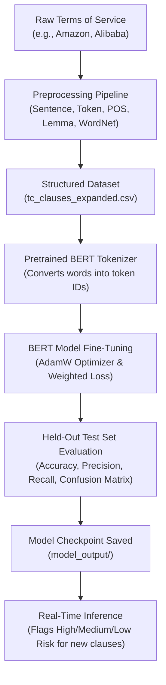

# 1. Project Overview and Core Concepts

## 1. What is this project about?
When you download an app or sign up for a service (like Amazon, Alibaba, Netflix, or Instagram), you are asked to click **"I Agree"** to the **Terms and Conditions (T&C)**.

- **The Problem:** Nobody reads these agreements. They are 10 to 30 pages long and full of confusing legal language ("legalese" — fancy lawyer-speak that normal people can't understand).
- **The Danger:** Companies hide scary terms inside them:
  - *"We can terminate your account at any moment without giving you a reason or notice."* (Unilateral Termination — they can kick you out whenever they want)
  - *"If our servers crash and you lose thousands of dollars, we will not pay you a penny."* (Limitation of Liability — they don't pay for your losses)
  - *"You give up your right to sue us in court or join a class action lawsuit; you must go to private arbitration."* (Mandatory Arbitration — you can't take them to court)
- **Our Solution:** We built an automated NLP system. It takes a legal agreement, cleans and reads through it, and labels each clause as **Low Risk**, **Medium Risk**, or **High Risk** — so users instantly know what they're agreeing to.

---

## 2. The Big Picture: What Was Already Done vs What Was Added

Our project has two major halves:

### Part 1: The Foundational Preprocessing Work (Experiments 1–5 & HMM)
*(Documented in `nlpExps(1-5).pdf` and `hmm-posTagging-implementation.pdf`)*
This part was completed earlier in Google Colab:
- **Experiment 1:** Compared NLP tools (NLTK, spaCy, Hugging Face, Google Cloud NLP, AWS Comprehend).
- **Experiment 2:** Defined the problem and read related legal NLP research (like ToS;DR — a public project that rates T&C fairness).
- **Experiment 3:** Built basic text cleaning (removing HTML tags, handling numbers, keeping important words like "not" and "no").
- **Experiment 4:** Advanced cleaning (Lemmatization vs Stemming, hiding private data like emails and names for privacy, detecting language).
- **Experiment 5:** Understanding sentence grammar (Noun/Verb phrases, finding who does what via Subject-Verb-Object triples, building parse trees).
- **HMM Implementation:** Built a Hidden Markov Model (a probability-based sequence prediction method) with the Viterbi algorithm (a smart way to find the best sequence of tags) to predict POS tags from scratch.

### Part 2: The New Requirements Added Now (October 2026 Guidelines)
The instructor asked for real machine learning and deep learning — not just text cleaning:
1. **The 5 Mandatory Preprocessing Tasks:** Packaged into a clean Python script (`preprocessing_pipeline.py`) so anyone can run and verify them.
2. **Dataset Expansion:** Grew our starting dataset from 17 clauses to 82 clauses from 11 real platforms (`tc_clauses_expanded.csv`).
3. **Genuine Fine-Tuning of a Pretrained LLM/Transformer:** Used a real BERT model (`bert-tiny`) — BERT is a powerful language model made by Google — and updated its internal number weights using PyTorch (a machine learning library).
4. **Baseline Benchmarking:** Built a simple old-school ML model (TF-IDF + Logistic Regression) to compare against our BERT model and see if deep learning actually helped.
5. **Rigorous Evaluation:** Measured Accuracy, Precision, Recall, Macro F1, and the Confusion Matrix on a test set the model had never seen.
6. **Inference Pipeline:** Built `inference.py` — give it any new legal sentence and it instantly tells you the risk level with confidence percentages.
7. **Complete Documentation & Slides:** Reports, slides, flowchart diagrams, and form answers.

---

## 3. High-Level Flow of the System

---

## 4. Key Takeaways for the Team
- We did **NOT** rewrite or delete Experiments 1–5. We kept them and built the fine-tuning system on top of them.
- Our fine-tuning is **real training** using PyTorch and loss backpropagation (the model actually learns from mistakes). It is NOT just calling an API or asking a chatbot.
- The next documentation files explain each part in simple terms!
